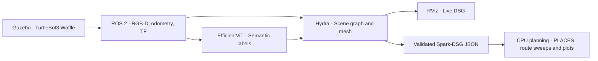

# Hydra-ACRL

   

Hydra-ACRL builds semantic 3D scene graphs from a simulated TurtleBot3 Waffle in the AWS Small House. It uses those graphs to study how clearance and assumed uncertainty affect route choice. Mapping and saved-graph planning are independent modules connected by an exported Spark-DSG JSON file.



**Release status.** The native pipeline and CPU Docker planning are verified. Full Docker mapping validation is pending because the host NVIDIA driver rejected the pinned CUDA 12.6.3 image. A public clone supports CPU planning with your own compatible DSG. Mapping includes the robot configuration and the required Small House assets. Setup fetches pinned Kimera-RPGO automatically. The EfficientViT ONNX is the only application file users supply. [Publication inventory](docs/PUBLICATION.md) · [Validation report](docs/IMPLEMENTATION_REPORT.md)

## Quick start

### Inspect a graph with Docker

From the repository root, build the CPU image with Docker, BuildKit and Compose. Provide your own Spark-DSG JSON with a PLACES layer.

```bash
bash docker/build.sh --planning-only
mkdir -p docker-data/input
cp /absolute/path/to/graph.json docker-data/input/
bash docker/run.sh --planning python scripts/inspect_small_house.py --dsg /input/graph.json
```

For the native CPU installation, use Python 3.12 with venv, CMake, a C++ compiler and Eigen headers. The setup builds the pinned Spark-DSG binding. It also accepts a compatible wheel via `--spark-wheel`. [Planning guide](hydra_task_and_motion_planning/README.md)

```bash
./hydra_task_and_motion_planning/setup.sh --viz
cd hydra_task_and_motion_planning
.venv/bin/python scripts/inspect_small_house.py --dsg /absolute/path/to/graph.json
```

### Install native mapping

Use an Ubuntu 24.04 workstation with the ROS 2 Jazzy, Gazebo Harmonic, CUDA 12.6 and TensorRT 10.4 development prerequisites. Setup fetches pinned Kimera-RPGO and builds both overlays sequentially. Use `--resume` if compilation is interrupted. [Native prerequisites](hydra_mapping/README.md#setup)

```bash
git clone https://github.com/sidhantjha/hydra-acrl.git
cd hydra-acrl
bash hydra_mapping/setup.sh
bash hydra_task_and_motion_planning/setup.sh --viz
./launch.sh
```

**One model file before the first mapping run.** Obtain an authorized copy of `ade20k-efficientvit_seg_l2.onnx` from the project maintainer and place it in `hydra_mapping/external/models/`, creating the directory if needed. The launcher verifies SHA256 `bce5de3bf3707258e7a2eff36b2f705595e6efcaeaab8e052f341057853a0072`. MIT SPARK's published download links currently return 404. TensorRT builds its engine locally. [Upstream model documentation](https://github.com/MIT-SPARK/semantic_inference/blob/d8ca2e60ca7b872aea73fd28be37b1a3b919eab8/docs/closed_set.md#models)

### Install Docker mapping

The mapping image includes the toolchain and uses the same dashboard. From the same clone and with the ONNX in the path above:

```bash
bash docker/build.sh
bash docker/run.sh
```

Mapping in Docker still needs a host NVIDIA driver accepted by CUDA 12.6.3. GPU passthrough worked on driver 551.95, but the image compatibility check rejected it. The standalone CPU image has no GPU requirement. [Docker setup, mounts and display configuration](docker/README.md)

## Four-pane dashboard

| Pane | Purpose |
| --- | --- |
| Mapping backend | Starts the simulator and Hydra, checks readiness, and saves and exports the DSG at shutdown. |
| Gazebo GUI | Attaches to the simulator after the Waffle spawns. |
| Manual keyboard teleoperation | Publishes stamped velocity commands. Press **F3** to focus this pane. |
| Hydra visualizer and RViz | Displays the live backend graph. The RViz fixed frame is `map`. |

Use `i` to drive, `j` or `l` to turn, and `k` or **Space** to stop motion. Movement can continue after key release. To save and stop, press **Ctrl+C** in the mapping pane or run `./launch.sh stop SESSION` using the printed session name. **Ctrl+B**, then **D**, detaches the dashboard and leaves it running. The Docker launcher prints the equivalent host commands. An existing TensorRT engine prompts for reuse or rebuild. For noninteractive runs, use `--reuse-engine` or `--rebuild-engine` explicitly. [Manual startup, ROS topics and troubleshooting](hydra_mapping/README.md#manual-startup)

## Mapping to planning

The validated native export is `hydra_mapping/runs/SESSION/dsg.json`. Docker saves it under `docker-data/runs/SESSION/dsg.json`. The same run directory retains logs, raw Hydra outputs and a report identifying the graph and available mesh files.

```bash
cd hydra_task_and_motion_planning
.venv/bin/python scripts/inspect_small_house.py --dsg /absolute/path/to/dsg.json
.venv/bin/python scripts/sweep_uncertainty.py --dsg /absolute/path/to/dsg.json
```

For Docker planning, copy an authorized export into `docker-data/input/` and pass its `/input/` path. The [planning guide](hydra_task_and_motion_planning/README.md) covers visualization, the historical fixture and all four regressions.

## Repository tour

```text
launch.sh                         native four-pane dashboard
Dockerfile, compose.yaml          local image and runtime mounts
docker/                           container scripts and guide
hydra_mapping/
  hydra.repos                     pinned upstream revisions
  hydra_ws/src/                   Hydra, ROS integration and dependencies
  tb3_ws/src/tb3_hydra_bringup/     launch files, mapping config and adapters
  small_house/                    pinned world-referenced models and textures
  scripts/                        dependency preparation, mapping and export
hydra_task_and_motion_planning/
  src/swarmx_planning/             graph IO, PLACES, A* and clearance constraints
  scripts/                        inspection, sweeps and plots
  experiments/, tests/            historical notes and regression code
docs/                             architecture, verification, publication and screenshots
```

The [mapping module](hydra_mapping/) owns simulation and live graph generation. The [planning module](hydra_task_and_motion_planning/) owns saved-graph analysis and the experimental waypoint controller. [Approved screenshot location](docs/screenshots/) · [Architecture notes](docs/ARCHITECTURE.md)

## Verified results and limitations

- **Native graph and mesh.** The unified dashboard run exported **218 nodes, 624 edges and 95 PLACES nodes** with Hydra exit code 0. Both mesh files were saved, and CPU planning loaded the graph. An earlier run exported 314 nodes and 948 edges.
- **Robot and visualization.** Native validation covered Waffle spawn, real TensorRT inference, stamped keyboard motion and live RViz visualization.
- **Planning.** All four regressions passed natively and in Docker with a local reference fixture. The historical sweep CSV reproduced byte for byte. On that reference, raising clearance from 0.40 m to 1.00 m increased the XY route length from 11.493 m to 12.428 m.
- **Limitations.** Gazebo’s server can segfault during teardown while Hydra saves independently. The waypoint controller uses preset waypoints and stalled in historical tests. Clearance sweeps use synthetic uncertainty margins and graph connectivity. Traversability certification and autonomous execution of planned paths remain research work. [Verification record](docs/IMPLEMENTATION_REPORT.md)

## Acknowledgements

Hydra-ACRL integrates Hydra, Hydra-ROS and Spark-DSG from MIT SPARK, Kimera, EfficientViT, NVIDIA TensorRT, ROS 2, Gazebo, ROBOTIS TurtleBot3 resources and AWS RoboMaker Small House. [Third-party notices](THIRD_PARTY_NOTICES.md) · [Source revisions](hydra_mapping/hydra.repos)
