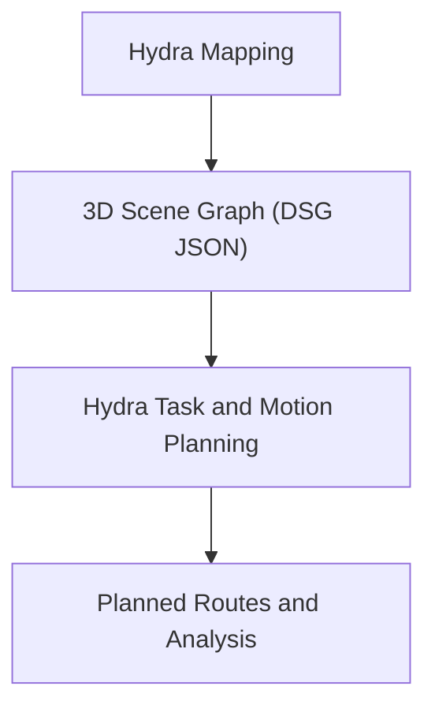

# Hydra-ACRL

   

## 1. Project overview

Use Hydra-ACRL to map a simulated house and study how changing clearance requirements affects route choice. Its two modules work independently and exchange a saved graph.

- [Hydra mapping](hydra_mapping/) uses Hydra, Gazebo, a TurtleBot3 Waffle and ROS 2 to build a semantic 3D scene graph.
- [Hydra task and motion planning](hydra_task_and_motion_planning/) reads the graph for graph processing, uncertainty-aware planning and visualization. It also contains a separate experimental waypoint controller. Saved-graph routes are not sent automatically to the robot.



## 2. Installation step by step

### Install native mapping

1. **Check the machine.** Use Ubuntu 24.04 on x86-64 with an NVIDIA GPU for mapping. Use a desktop terminal with working graphics for Gazebo and RViz. The native stack was tested with ROS 2 Jazzy, Gazebo Harmonic, CUDA 12.6 (`nvcc` 12.6.85), TensorRT 10.4.0.26, Python 3.12 and Spark-DSG 1.1.3. For CPU-only planning, clone the repository and follow the CPU instructions in step 6 or use Docker.

   ```bash
   cat /etc/os-release
   uname -m
   ```

2. **Clone the repository.** From the directory where you keep your research projects, install Git and clone the source.

   ```bash
   sudo apt update
   sudo apt install git
   git clone https://github.com/sidhantjha/hydra-acrl.git
   cd hydra-acrl
   ```

3. **Install system dependencies.** Run the following commands in Ubuntu. First enable Ubuntu Universe and add the ROS 2 package source. Install the compiler, Python environment tools, ROS 2 Jazzy, the ROS packages for Gazebo Harmonic and TurtleBot3, RViz, keyboard teleoperation, and the native libraries used by the overlays. [ROS 2 Jazzy Ubuntu installation](https://docs.ros.org/en/jazzy/Installation/Ubuntu-Install-Debs.html)

   ```bash
   sudo apt update
   sudo apt install ca-certificates curl software-properties-common
   sudo add-apt-repository -y universe
   curl -fL https://github.com/ros-infrastructure/ros-apt-source/releases/download/1.3.0/ros2-apt-source_1.3.0.noble_all.deb \
     -o /tmp/ros2-apt-source_1.3.0.noble_all.deb
   echo 'f31d84adf5054c7d60ded0e82c0f776a77ea33af53d08f40b9ad7c94cca55296  /tmp/ros2-apt-source_1.3.0.noble_all.deb' | sha256sum -c - &&
     sudo apt install /tmp/ros2-apt-source_1.3.0.noble_all.deb
   sudo apt update
   sudo apt install build-essential cmake pkg-config python3-dev python3-venv \
     python3-colcon-common-extensions python3-flask python3-numpy tmux \
     libboost-filesystem-dev libboost-system-dev libcli11-dev libeigen3-dev \
     libgflags-dev libgoogle-glog-dev libopencv-dev libpcl-dev libyaml-cpp-dev \
     libzmq3-dev nlohmann-json3-dev pybind11-dev libegl1 libgl1-mesa-dri \
     libglx-mesa0 mesa-utils \
     ros-jazzy-ros-base ros-jazzy-rosidl-default-generators ros-jazzy-ros-gz \
     ros-jazzy-cv-bridge ros-jazzy-image-geometry ros-jazzy-image-transport-plugins \
     ros-jazzy-gtsam ros-jazzy-interactive-markers ros-jazzy-rosbag2 ros-jazzy-rviz2 \
     ros-jazzy-tf2-eigen ros-jazzy-topic-tools ros-jazzy-turtlebot3-gazebo \
     ros-jazzy-teleop-twist-keyboard
   ```

   Install a compatible NVIDIA driver using the instructions for your host. On WSL2, install the NVIDIA driver on Windows and use WSLg for desktop windows. Inside WSL, install the toolkit-only package shown below. Confirm that `nvidia-smi` sees the GPU before continuing. [NVIDIA Linux driver installation](https://docs.nvidia.com/datacenter/tesla/driver-installation-guide/index.html) · [NVIDIA CUDA on WSL](https://docs.nvidia.com/cuda/wsl-user-guide/index.html)

   Add NVIDIA's Ubuntu 24.04 package source. The following installs the CUDA 12.6 toolkit and the TensorRT 10.4 C++ runtime, headers, plugins and ONNX parser. [CUDA 12.6.3 installation](https://docs.nvidia.com/cuda/archive/12.6.3/cuda-installation-guide-linux/index.html#network-repo-installation-for-ubuntu) · [TensorRT Debian installation](https://docs.nvidia.com/deeplearning/tensorrt/latest/installing-tensorrt/installing.html#method-2-debian-package-installation) · [TensorRT 10.4 release notes](https://docs.nvidia.com/deeplearning/tensorrt/10.x.x/getting-started/release-notes-10/10.4.0.html)

   ```bash
   nvidia-smi
   curl -fL https://developer.download.nvidia.com/compute/cuda/repos/ubuntu2404/x86_64/cuda-keyring_1.1-1_all.deb \
     -o /tmp/cuda-keyring_1.1-1_all.deb
   sudo apt install /tmp/cuda-keyring_1.1-1_all.deb
   sudo apt update
   sudo apt install cuda-toolkit-12-6=12.6.3-1
   trt_version=10.4.0.26-1+cuda12.6
   sudo apt install "libnvinfer10=$trt_version" "libnvinfer-headers-dev=$trt_version" \
     "libnvinfer-dev=$trt_version" "libnvinfer-plugin10=$trt_version" \
     "libnvinfer-headers-plugin-dev=$trt_version" "libnvinfer-plugin-dev=$trt_version" \
     "libnvonnxparsers10=$trt_version" "libnvonnxparsers-dev=$trt_version"
   /usr/local/cuda-12.6/bin/nvcc --version
   ```

4. **Place the EfficientViT model.** Obtain an authorized copy of `ade20k-efficientvit_seg_l2.onnx` from the project maintainer. The upstream model download links returned HTTP 404 during release validation. From the repository root, replace `/path/to/` with the actual location of your copy. Expect `OK` from the checksum check. TensorRT generates a machine-specific engine at first launch. [MIT SPARK model catalog](https://github.com/MIT-SPARK/semantic_inference/blob/d8ca2e60ca7b872aea73fd28be37b1a3b919eab8/docs/closed_set.md#models)

   ```bash
   mkdir -p hydra_mapping/external/models
   cp /path/to/ade20k-efficientvit_seg_l2.onnx hydra_mapping/external/models/
   echo 'bce5de3bf3707258e7a2eff36b2f705595e6efcaeaab8e052f341057853a0072  hydra_mapping/external/models/ade20k-efficientvit_seg_l2.onnx' | sha256sum -c -
   ```

5. **Build mapping.** From the repository root, select CUDA 12.6 explicitly and run setup. It checks the installed prerequisites, fetches pinned Kimera-RPGO, uses the bundled Small House assets, then builds the Hydra and TurtleBot3 overlays. Colcon builds packages in dependency order with its sequential executor, and `MAKEFLAGS=-j1` and `CMAKE_BUILD_PARALLEL_LEVEL=1` limit compiler jobs within each package. Expect 22 packages in the first overlay, one in the second, and the message `Built both overlays`. [Mapping setup](hydra_mapping/README.md#setup)

   ```bash
   export CUDAToolkit_ROOT=/usr/local/cuda-12.6
   bash hydra_mapping/setup.sh
   ```

   After fixing the cause of an interrupted or failed build, run `bash hydra_mapping/setup.sh --resume` from the same terminal and directory. It skips packages with successful colcon build records.

6. **Install planning.** Run this from the repository root. Setup creates `hydra_task_and_motion_planning/.venv/`, builds the Spark-DSG 1.1.3 Python binding, and installs the planning and visualization packages. A CPU-only workstation can skip the mapping steps and install just the basic development packages shown here. [Planning setup](hydra_task_and_motion_planning/README.md)

   ```bash
   # On a CPU-only workstation that skipped the mapping prerequisites
   sudo apt install build-essential cmake python3-dev python3-venv libeigen3-dev nlohmann-json3-dev
   ```

   ```bash
   bash hydra_task_and_motion_planning/setup.sh --viz
   ```

7. **Verify installation.** From the repository root, check the model, assets and mapping prerequisites, then confirm ROS can discover both overlays. CPU-only users can run just the last two Python checks. The package prefixes should point inside this checkout, and Python should print `1.1.3`.

   ```bash
   CUDAToolkit_ROOT=/usr/local/cuda-12.6 bash hydra_mapping/setup.sh --check-only
   source /opt/ros/jazzy/setup.bash
   source hydra_mapping/hydra_ws/install/local_setup.bash
   source hydra_mapping/tb3_ws/install/local_setup.bash
   ros2 pkg prefix hydra_ros
   ros2 pkg prefix tb3_hydra_bringup
   hydra_task_and_motion_planning/.venv/bin/python -I -m pip check
   hydra_task_and_motion_planning/.venv/bin/python -I -c 'from importlib.metadata import version; import spark_dsg, swarmx_planning.graph_io; print(version("spark-dsg"))'
   ```

### Docker installation

**CPU planning is verified.** Install Docker with BuildKit and Compose, then build the planning image from the repository root. It needs no GPU or ROS installation on the host. See [the saved-graph example](#7-run-planning-on-a-saved-dsg) for running the image with your data. [Docker Engine for Ubuntu](https://docs.docker.com/engine/install/ubuntu/) · [Docker guide](docker/README.md)

```bash
docker info
docker compose version
bash docker/build.sh --planning-only
```

**GPU mapping in Docker is pending validation.** The CUDA 12.6.3 container preflight rejected driver `551.95` even though a basic GPU passthrough test passed. NVIDIA lists driver `561.17` or later on Windows and `560.35.05` or later on Linux for this toolkit release. Use a driver accepted by the pinned image. On native Linux, configure NVIDIA Container Toolkit. The Docker guide documents WSL2 and display setup. Once the host is ready and the ONNX file is in place, the intended workflow from the repository root is `bash docker/build.sh` followed by `bash docker/run.sh`. Use the native instructions for a verified mapping workflow. [CUDA 12.6.3 driver compatibility](https://docs.nvidia.com/cuda/archive/12.6.3/cuda-toolkit-release-notes/index.html) · [NVIDIA Container Toolkit](https://docs.nvidia.com/datacenter/cloud-native/container-toolkit/latest/install-guide.html) · [Docker mapping guide](docker/README.md)

## 3. Run your first mapping session

1. **Open the dashboard.** From the repository root, run the launcher in a desktop terminal. If a TensorRT engine already exists, choose reuse or rebuild when prompted. For scripted runs the flags are `--reuse-engine` and `--rebuild-engine`.

   ```bash
   cd /path/to/hydra-acrl
   export CUDAToolkit_ROOT=/usr/local/cuda-12.6
   ./launch.sh
   ```

2. **Read the four panes.** The launcher starts the Gazebo server headless so the world and Waffle can load before the GUI attaches. Once the robot exists, it checks the stamped velocity bridge and odometry, starts keyboard teleoperation, and connects the Hydra visualizer to the backend graph.

   | Pane | What to look for |
   | --- | --- |
   | Mapping backend | Readiness checks, semantic inference, live graph updates, shutdown and export. |
   | Gazebo GUI | Attaches after the robot spawns. Look here to see where the Waffle is driving. |
   | Manual keyboard teleoperation | Sends stamped velocity commands. Press **F3** to focus this pane. |
   | Hydra visualizer and RViz | Displays the graph from `/hydra/backend/dsg`. The RViz fixed frame is `map`. |

3. **Wait for “Mapping is live.”** The backend waits for real semantic images and live graph messages. Building the first TensorRT engine can take several minutes. Then press **F3** and use **i** to drive, **j** or **l** to turn, and **k** or **Space** to stop. Drive through the rooms while checking the robot in Gazebo and the graph growing in RViz. Pressing no key can leave the last motion command active.
4. **Stop and save.** Press **k** in teleoperation. Focus **Mapping backend** and press **Ctrl+C** once, or run the following from a second terminal at the repository root. Replace the prompt value with the full dashboard session name shown by the launcher. Wait for **“DSG and export report saved”** before closing the dashboard.

   ```bash
   read -r -p 'Dashboard session name: ' SESSION
   ./launch.sh stop "$SESSION"
   ```

   **Ctrl+B**, then **D**, detaches tmux and leaves mapping running. Reattach with `tmux -L "$SESSION" attach -t "$SESSION"`. The stop command closes the auxiliary processes and gives Hydra time to save before export.

5. **Find and check the export.** From the repository root, enter the session name. Confirm a clean Hydra exit, a nonempty graph and the recorded artifact states.

   ```bash
   read -r -p 'Dashboard session name: ' SESSION
   RUN="hydra_mapping/runs/$SESSION"
   test -s "$RUN/dsg.json" && python3 -m json.tool "$RUN/dsg.json.export.json"
   ```

   A successful dashboard run has this layout. The mesh artifacts are listed when Hydra saved them.

   ```text
   hydra_mapping/runs/SESSION/
   ├── dsg.json                      Validated backend graph to use for planning
   ├── dsg.json.export.json          Hydra exit, graph counts, SHA-256 and artifact states
   ├── mapping-backend.log           Mapping console, startup and export
   ├── readiness.log                 Robot, ROS topic and graph probes
   ├── gazebo-gui.log                Gazebo GUI output
   ├── teleoperation.log             Keyboard control output
   ├── visualizer.log                Visualizer and RViz console output
   ├── visualizer-ros-logs/          ROS logs for the visualizer launch
   └── mapping/
       ├── config/                    Copies of run inputs
       ├── run_metadata.txt           Model checksum and run settings
       ├── hydra_exit.json            Hydra process exit record
       ├── ros_logs/                   ROS launch logs for mapping
       └── hydra/
           ├── hydra_config.yaml      Hydra's effective configuration
           └── backend/
               ├── dsg.json           Raw backend scene graph
               ├── dsg_with_mesh.json Graph with embedded mesh data
               └── mesh.ply           Geometry for external mesh viewers
   ```

For separate simulator, teleop and RViz terminals, follow the [manual startup and export instructions](hydra_mapping/README.md#manual-startup). Use `./launch.sh --headless` to skip both desktop windows, or `./launch.sh --no-rviz` to keep Gazebo and skip RViz.

## 4. Understanding the repository

```text
launch.sh                           Start or stop the four-pane dashboard
hydra_mapping/
├── setup.sh                        Check prerequisites and build both ROS overlays
├── hydra_ws/                       Hydra engine and upstream dependencies
├── tb3_ws/                         Custom TurtleBot3 and Gazebo integration
├── small_house/                    Bundled AWS Small House models and textures
├── scripts/                        Prepare inputs, run mapping and export a DSG
├── external/                       Local model and asset preparation files
└── runs/                           Local mapping outputs
hydra_task_and_motion_planning/
├── setup.sh                        Build the independent Python environment
├── pyproject.toml                  Package metadata and visualization extras
├── requirements.txt                Python dependency pins
├── src/                            Graph processing, planning and experimental control
├── scripts/                        Graph inspection, planning and visualizations
├── experiments/                    Experiment notes and local reference data location
├── tests/                          Historical fixture and export regressions
└── results/                        Local planning outputs
docker/                              Container setup, launch and usage guide
docs/                                Architecture, validation and publication records
```

Start with the [mapping guide](hydra_mapping/README.md), [planning guide](hydra_task_and_motion_planning/README.md), [Docker guide](docker/README.md) or [project docs](docs/). The source lives in [`hydra_ws/src`](hydra_mapping/hydra_ws/src/), the [custom bringup package](hydra_mapping/tb3_ws/src/tb3_hydra_bringup/), and [the planning package](hydra_task_and_motion_planning/src/swarmx_planning/). The checkout includes [Small House assets](hydra_mapping/small_house/), [mapping scripts](hydra_mapping/scripts/) and [experiment notes](hydra_task_and_motion_planning/experiments/).

The workspaces generate `build/`, `install/` and `log/` locally. Git also excludes `external/`, `runs/`, the planning `.venv/` and `results/`, `docker-data/`, model weights, TensorRT engines and the historical reference DSG. The pinned [upstream source manifest](hydra_mapping/hydra.repos) records where dependencies come from.

## 5. Hydra mapping — where to modify the code

[`hydra_ws`](hydra_mapping/hydra_ws/) contains core Hydra, Hydra-ROS, Spark-DSG, semantic inference, Kimera and support libraries. [`tb3_ws`](hydra_mapping/tb3_ws/) contains the project-owned bringup package, including the simulated robot, sensors, image adapters, bridges, TF and launch files. Start with `tb3_ws` for simulation and robot integration changes.

| What I want to change | File to edit | Explanation |
| --- | --- | --- |
| Simulation world | [`small_house_hydra.world`](hydra_mapping/tb3_ws/src/tb3_hydra_bringup/worlds/small_house_hydra.world) | Edit model placement, lighting and Gazebo plugins. |
| Robot spawn position | [`small_house_record_run.launch.py`](hydra_mapping/tb3_ws/src/tb3_hydra_bringup/launch/small_house_record_run.launch.py) | This launch passes the Small House `x`, `y` and `z` to [`spawn_robot.launch.py`](hydra_mapping/tb3_ws/src/tb3_hydra_bringup/launch/spawn_robot.launch.py). |
| Robot model | [`model.sdf`](hydra_mapping/tb3_ws/src/tb3_hydra_bringup/models/hydra_waffle/model.sdf) | Links, joints, meshes, sensors and the differential drive plugin. |
| Camera position and orientation | [`model.sdf`](hydra_mapping/tb3_ws/src/tb3_hydra_bringup/models/hydra_waffle/model.sdf) and [`hydra_interface_semantic.launch.py`](hydra_mapping/tb3_ws/src/tb3_hydra_bringup/launch/hydra_interface_semantic.launch.py) | Keep the Gazebo RGB and depth sensor poses consistent with the ROS camera transform. Preserve the optical-frame convention. |
| Camera resolution and depth range | [`model.sdf`](hydra_mapping/tb3_ws/src/tb3_hydra_bringup/models/hydra_waffle/model.sdf) and [`hydra_input.yaml`](hydra_mapping/tb3_ws/src/tb3_hydra_bringup/config/hydra_input.yaml) | The SDF sets 720×480 images and depth clipping. The input YAML defines Hydra's accepted depth range. |
| ROS–Gazebo bridges | [`bridge.yaml`](hydra_mapping/tb3_ws/src/tb3_hydra_bringup/config/bridge.yaml) and [`small_house_record_run.launch.py`](hydra_mapping/tb3_ws/src/tb3_hydra_bringup/launch/small_house_record_run.launch.py) | YAML handles bridge messages including stamped velocity. The launch starts the RGB image bridge separately. |
| TF and camera adapters | [`hydra_interface_semantic.launch.py`](hydra_mapping/tb3_ws/src/tb3_hydra_bringup/launch/hydra_interface_semantic.launch.py), [`image_adaptor_semantic.py`](hydra_mapping/tb3_ws/src/tb3_hydra_bringup/tb3_hydra_bringup/nodes/image_adaptor_semantic.py), [`small_house_mapping.launch.py`](hydra_mapping/tb3_ws/src/tb3_hydra_bringup/launch/small_house_mapping.launch.py) | The interface starts static TF and relays, the adapter sets message frames, and the mapping launch publishes `world → map`. |
| Hydra mapping parameters | [`hydra.yaml`](hydra_mapping/tb3_ws/src/tb3_hydra_bringup/config/hydra.yaml) | Mapping window, reconstruction resolution and truncation. |
| Hydra input configuration | [`hydra_input.yaml`](hydra_mapping/tb3_ws/src/tb3_hydra_bringup/config/hydra_input.yaml) and [`small_house_mapping.launch.py`](hydra_mapping/tb3_ws/src/tb3_hydra_bringup/launch/small_house_mapping.launch.py) | Input frames and sensor limits are in YAML. Topic remaps are in the launch. |
| Semantic segmentation | [`semantic_segmentation.launch.py`](hydra_mapping/tb3_ws/src/tb3_hydra_bringup/launch/semantic_segmentation.launch.py) and [EfficientViT model YAML](hydra_mapping/hydra_ws/src/semantic_inference/semantic_inference_ros/config/models/ade20k-efficientvit_seg_l2.yaml) | Selects model and label space. The inference package owns the model's settings. |
| RViz settings | [`streaming_visualizer.rviz`](hydra_mapping/hydra_ws/src/hydra_ros/hydra_visualizer/rviz/streaming_visualizer.rviz) and [`small_house_visualizer.launch.py`](hydra_mapping/tb3_ws/src/tb3_hydra_bringup/launch/small_house_visualizer.launch.py) | The RViz file configures displays and frames. The wrapper starts the streaming visualizer and remaps the DSG topic. |
| Mapping startup | [`launch.sh`](launch.sh), [`run_mapping.sh`](hydra_mapping/scripts/run_mapping.sh) and [`small_house_mapping.launch.py`](hydra_mapping/tb3_ws/src/tb3_hydra_bringup/launch/small_house_mapping.launch.py) | Dashboard sequencing and readiness, run setup, and ROS nodes respectively. |
| DSG export | [`export_dsg.sh`](hydra_mapping/scripts/export_dsg.sh) and [`export_dsg.py`](hydra_mapping/scripts/export_dsg.py) | Locks the run, checks Hydra's exit and the graph, then writes the export and report. |

After editing a bringup launch, SDF, world, YAML or adapter, rebuild just the installed custom package. Run from the repository root in a fresh terminal after the initial full build. Restart mapping to load the new configuration.

```bash
source /opt/ros/jazzy/setup.bash
source hydra_mapping/hydra_ws/install/local_setup.bash
(
  cd hydra_mapping/tb3_ws
  MAKEFLAGS=-j1 CMAKE_BUILD_PARALLEL_LEVEL=1 colcon build --executor sequential --packages-select tb3_hydra_bringup
)
```

An upstream RViz or segmentation resource belongs to its own package. Rebuild the package that owns the edited installed file. Edits to the root dashboard and shell or export scripts are read directly on the next invocation.

## 6. Task and motion planning — how it works

1. Load a saved Spark-DSG JSON and extract the `PLACES` layer. Its nodes provide a 3D position and clearance, and its edges connect neighboring places.
2. Choose two distinct node IDs in the same connected component.
3. Set the clearance requirement and any graph filters your experiment uses. The shared planner uses the supplied edges. The historical Small House scripts also filter edges with more than 0.8 m vertical change.
4. Run graph search and review route length, stretch and the minimum interior clearance.
5. Plot the route and compare it across uncertainty assumptions.

In the shared planner, **required clearance = robot radius + control margin + assumed perception uncertainty**, all in meters. Raising uncertainty can remove interior nodes from consideration, change the shortest route or leave no feasible route. Start and goal are exempt from the clearance threshold. These are illustrative graph constraints. They do not measure perception uncertainty or certify physical traversability. The shared A* uses XYZ distances. The historical Small House sweep uses XY lengths after height filtering.

| Source | Main API, inputs and outputs | Used by |
| --- | --- | --- |
| [`graph_io.py`](hydra_task_and_motion_planning/src/swarmx_planning/graph_io.py) | `load_dsg(path)` checks the JSON path and returns a Spark-DSG `DynamicSceneGraph`. | General sweep, A* plot, tests and custom scripts. |
| [`places.py`](hydra_task_and_motion_planning/src/swarmx_planning/places.py) | `extract_places(graph)` returns a dictionary of `PlaceNode` records and edge pairs. Records have ID, XYZ position, clearance and a basis-point count. | Shared planning, metrics and general CLI tools. |
| [`planner.py`](hydra_task_and_motion_planning/src/swarmx_planning/planner.py) | `build_adjacency` weights undirected edges by XYZ distance. `astar` and `astar_with_min_clearance` take nodes, edges and endpoint IDs and return route IDs and length. The latter additionally takes a clearance threshold. No route raises `ValueError`. | Baseline A* visualization and the uncertainty wrapper. |
| [`uncertainty.py`](hydra_task_and_motion_planning/src/swarmx_planning/uncertainty.py) | `PlanningCertificate` stores radius, control margin and perception uncertainty and computes `required_clearance`. `uncertainty_aware_plan` returns route IDs and length via the constrained A*. | General uncertainty sweep and custom experiments. |
| [`metrics.py`](hydra_task_and_motion_planning/src/swarmx_planning/metrics.py) | `build_adjacency` and `connected_components` return unweighted connectivity. `print_graph_metrics` prints graph statistics. `path_metrics(nodes, path)` reports length, stretch and clearance, including interior bottlenecks. | Sweep, baseline visualization and regression tests. |
| [`control/waypoint_controller.py`](hydra_task_and_motion_planning/src/swarmx_planning/control/waypoint_controller.py) | `WaypointController` receives odometry and publishes stamped velocity commands to follow preset XY goals. `main()` spins the ROS node. | Experimental robot-control source, separate from saved-graph planning. |

## 7. Run planning on a saved DSG

**Inspect and sweep.** Open a new terminal without sourcing ROS and enter the dashboard session name from the repository root. These commands invoke the virtual environment directly. Once you have the JSON, you can run them without ROS, Gazebo or a running Hydra instance. For a graph from elsewhere, set `DSG` to its absolute path.

```bash
read -r -p 'Dashboard session name: ' SESSION
DSG="$PWD/hydra_mapping/runs/$SESSION/dsg.json"
cd hydra_task_and_motion_planning
.venv/bin/python scripts/inspect_small_house.py --dsg "$DSG"
.venv/bin/python scripts/sweep_uncertainty.py --dsg "$DSG"
mkdir -p results
OUT=$(mktemp -d "$PWD/results/first-route.XXXXXXXX")
MPLBACKEND=Agg .venv/bin/python scripts/visualize_astar.py --dsg "$DSG" --output-dir "$OUT"
printf 'Route plot: %s/visualize_astar.png\n' "$OUT"
```

The inspector prints counts, connectivity and example endpoint IDs with positions. The general sweep and A* plot choose X-extreme endpoints in the largest connected component. The sweep reports results in the terminal. The plot saves `visualize_astar.png` when given `--output-dir`, or opens a window without it.

**Choose endpoints and uncertainty.** Run this from the planning directory after the commands above. Enter two distinct PLACES IDs from the same connected component. The inspector's start and far-side candidate are a useful first pair. Edit `perception_uncertainty` to compare assumptions, or edit the illustrative values in [`sweep_uncertainty.py`](hydra_task_and_motion_planning/scripts/sweep_uncertainty.py) to run a custom sweep. These values are set in Python and are not CLI flags.

```bash
read -r -p 'Start PLACES ID: ' START
read -r -p 'Goal PLACES ID: ' GOAL
.venv/bin/python - "$DSG" "$START" "$GOAL" <<'PY'
import sys

from swarmx_planning.graph_io import load_dsg
from swarmx_planning.metrics import path_metrics
from swarmx_planning.places import extract_places
from swarmx_planning.uncertainty import PlanningCertificate, uncertainty_aware_plan

graph = load_dsg(sys.argv[1])
nodes, edges = extract_places(graph)
start, goal = sys.argv[2:]
if start == goal or start not in nodes or goal not in nodes:
    raise SystemExit("Choose two distinct PLACES IDs from this graph.")

assumptions = PlanningCertificate(
    robot_radius=0.15, control_margin=0.10, perception_uncertainty=0.15
)
try:
    route, length = uncertainty_aware_plan(nodes, edges, start, goal, assumptions)
except ValueError as error:
    raise SystemExit(str(error)) from error

print(f"Required clearance {assumptions.required_clearance:.2f} m")
print(f"Route length {length:.2f} m")
print(" → ".join(route))
print(path_metrics(nodes, route))
PY
```

If no route meets the threshold, pick another pair in the same component or try a lower threshold for comparison. The optional historical plot below compares routes for chosen endpoints with the Small House height filter. Its output can differ from the shared XYZ planner.

```bash
mkdir -p results
COMPARE=$(mktemp -d "$PWD/results/comparison.XXXXXXXX")
MPLBACKEND=Agg .venv/bin/python scripts/visualize_small_house_uncertainty.py \
  --dsg "$DSG" --start "$START" --goal "$GOAL" --output-dir "$COMPARE"
printf 'Comparison figure and CSV: %s\n' "$COMPARE"
```

**General-purpose scripts**

| Script | Purpose | When to use it |
| --- | --- | --- |
| [`inspect_small_house.py`](hydra_task_and_motion_planning/scripts/inspect_small_house.py) | Summarizes PLACES, connectivity and candidate endpoints. | Check any compatible saved graph before planning. Requires `--dsg`. |
| [`sweep_uncertainty.py`](hydra_task_and_motion_planning/scripts/sweep_uncertainty.py) | Runs clearance-constrained A* for several illustrative uncertainty values and prints changes. | First uncertainty sweep on a new graph. Requires `--dsg`. |
| [`visualize_astar.py`](hydra_task_and_motion_planning/scripts/visualize_astar.py) | Plots baseline A* in XY using XYZ search costs. | Inspect the baseline route. Use `--dsg` and optionally `--output-dir`. |

**Historical Small House scripts**

These require `--dsg`. The original results use the authorized historical reference DSG. On a fresh export, provide IDs from that graph using the supported flags. A graph can lack alternative routes under the historical filters. Use a new output directory to avoid collisions.

| Script | Purpose | When to use it |
| --- | --- | --- |
| [`find_small_house_route_switch.py`](hydra_task_and_motion_planning/scripts/find_small_house_route_switch.py) | Searches for a goal whose route changes under clearance thresholds. Prints the selection and route metrics. | Explore the historical route-switch experiment. Set `--start` if `p13061` is absent. The script chooses the goal. |
| [`visualize_small_house_uncertainty.py`](hydra_task_and_motion_planning/scripts/visualize_small_house_uncertainty.py) | Writes `small_house_uncertainty_routes.png` and `uncertainty_sweep.csv`. | Compare XY routes for known endpoints. Accepts `--start`, `--goal`, `--output-dir`. |
| [`animate_small_house_routes.py`](hydra_task_and_motion_planning/scripts/animate_small_house_routes.py) | Animates clearance-filtered NetworkX routes in 2D. Writes a GIF and attempts MP4. | Present the comparison. Accepts `--start`, `--goal`, `--output-dir`. |
| [`animate_small_house_routes_3d.py`](hydra_task_and_motion_planning/scripts/animate_small_house_routes_3d.py) | Animates clearance-filtered NetworkX routes in 3D and writes a GIF. | See height changes in the graph. Accepts `--start`, `--goal`, `--output-dir`. |

The historical plot and animations default to `p13061 → p2473` and write to the planning module's `results/` unless you specify another output directory. The graph is always selected explicitly with `--dsg`. [Historical experiment guide](hydra_task_and_motion_planning/README.md)

**Equivalent CPU Docker workflow.** From the repository root, after building the planning image, copy your own graph to the mounted input directory. Replace the example source path with your run's `dsg.json`. Choose a new output folder for repeat plots. `/input` and `/results` are the container paths.

```bash
mkdir -p docker-data/input
cp /path/to/dsg.json docker-data/input/first-map.json
bash docker/run.sh --planning python scripts/inspect_small_house.py --dsg /input/first-map.json
bash docker/run.sh --planning python scripts/sweep_uncertainty.py --dsg /input/first-map.json
bash docker/run.sh --planning python scripts/visualize_astar.py \
  --dsg /input/first-map.json --output-dir /results/first-route
```

The saved plot is `docker-data/results/first-route/visualize_astar.png` with the default mounts. [Docker mounts and regression workflow](docker/README.md)

## 8. Robot controller and waypoints

The experimental [`waypoint_controller.py`](hydra_task_and_motion_planning/src/swarmx_planning/control/waypoint_controller.py) has a preset list in `WaypointController.__init__`. Change that list to edit goal order or XY locations in meters.

```python
self.waypoints = [
    (2.0, 0.0),
    (4.0, 0.0),
    (8.0, 0.0),
    (8.0,-12.0),
]
```

The node reads XY and quaternion-derived yaw from `/odom`. It assumes the waypoints are expressed in the odometry frame and performs no TF conversion. A 0.1-second timer computes planar distance with `math.hypot` and heading with `atan2`, then wraps the heading error to `[-π, π]`. These are the gain and speed-limit lines in `control_loop()`.

```python
if abs(heading_error) > 0.05:
    angular = 0.8 * heading_error
    angular = max(min(angular, 0.4), -0.5)
    self.publish_cmd(0.0, angular)
    return

# THEN DRIVE FORWARD
linear = 1.5 * distance
linear = max(min(linear, 1.2), 0.05)

self.publish_cmd(linear, 0.0)
```

The controller turns in place above the 0.05 rad heading threshold. Otherwise it moves forward at 0.05–1.2 m/s. The angular command is limited to −0.5 to +0.4 rad/s. At a distance below 0.005 m it publishes zero velocity and advances to the next waypoint. After the final waypoint it continues publishing zero. `publish_cmd()` stamps the message, sets the command frame to `base_link`, and publishes a `TwistStamped` on `/cmd_vel`.

The controller defines `main()`, but the release declares no runnable console entry point or ROS executable for it. Its [old launch file](hydra_task_and_motion_planning/src/swarmx_planning/control/waypoint.launch.py.reference) is a reference. The controller was outside the validated mapping session, and historical tests reported stalling.

| Component | Role in the release |
| --- | --- |
| Manual teleoperation | Verified way to drive while generating a map. |
| Preset waypoint controller | Experimental ROS code that follows its own XY list. |
| Uncertainty-aware graph planner | Computes node sequences on a saved graph. |

A future integration could convert planned node IDs to XYZ positions using `extract_places`, transform suitable waypoints from graph coordinates to odometry, and pass them to a ROS-facing waypoint interface. That interface would also need to manage feedback and coordinate who publishes `/cmd_vel`.

## 9. Common development tasks

| I want to… | Where to edit | What to run afterwards |
| --- | --- | --- |
| Change the world | [Small House world](hydra_mapping/tb3_ws/src/tb3_hydra_bringup/worlds/small_house_hydra.world) | [Rebuild bringup](#5-hydra-mapping--where-to-modify-the-code), then `./launch.sh`. |
| Change the robot | [Waffle model](hydra_mapping/tb3_ws/src/tb3_hydra_bringup/models/hydra_waffle/model.sdf) | Rebuild bringup and restart the dashboard. |
| Change camera parameters | [Waffle model](hydra_mapping/tb3_ws/src/tb3_hydra_bringup/models/hydra_waffle/model.sdf) and [camera TF](hydra_mapping/tb3_ws/src/tb3_hydra_bringup/launch/hydra_interface_semantic.launch.py) | Rebuild bringup and check the sensor streams in a new run. |
| Change mapping parameters | [Bringup configuration](hydra_mapping/tb3_ws/src/tb3_hydra_bringup/config/) | Rebuild bringup and compare new exports. |
| Change robot waypoints or controller behavior | [Waypoint controller](hydra_task_and_motion_planning/src/swarmx_planning/control/waypoint_controller.py) | Review the [experimental integration limits](#8-robot-controller-and-waypoints) before adding a runnable ROS entry point. |
| Change shared A* behavior | [`planner.py`](hydra_task_and_motion_planning/src/swarmx_planning/planner.py) | Reinstall the planning package, then rerun the general sweep and plot. |
| Change uncertainty assumptions | [`uncertainty.py`](hydra_task_and_motion_planning/src/swarmx_planning/uncertainty.py) or [`sweep_uncertainty.py`](hydra_task_and_motion_planning/scripts/sweep_uncertainty.py) | Reinstall if you edited the package. Rerun the sweep on the same DSG. |
| Generate a new DSG | [Dashboard](launch.sh) | `./launch.sh`, drive, then stop and verify the export. |
| Plan with another DSG | [Planning example](#7-run-planning-on-a-saved-dsg) | Set `DSG` to its absolute path. Inspect and choose endpoints for that graph. |
| Generate visualizations | [Planning scripts](hydra_task_and_motion_planning/scripts/) | Run the plot or animation with a fresh `--output-dir`. |
| Run regression tests | [Reference tests](hydra_task_and_motion_planning/tests/test_reference.py) | Run the command below with the authorized fixture. |

When editing code under the planning module's `src/`, reinstall the local Python package so the venv sees the changes. From the planning directory:

```bash
.venv/bin/python -m pip install --no-deps .
```

From the same directory, run the four regressions after placing the authorized reference at `experiments/small_house/run_01/dsg.json`. They skip without that fixture. [Fixture details and checksum](hydra_task_and_motion_planning/README.md)

```bash
.venv/bin/python -B -I -m unittest discover -s tests -v
```

## 10. Results, limitations and troubleshooting

- **Native mapping.** The dashboard drove the simulated Waffle with stamped keyboard commands, used real TensorRT inference and displayed a live DSG. Hydra exited with code 0 and exported **218 nodes, 624 edges and 95 PLACES nodes**. Both mesh files were saved, and independent planning loaded the graph.
- **Fresh checkout.** All 23 packages built sequentially in isolation. A simulator probe using the bundled world received odometry, RGB and 32-bit depth. The isolated dashboard stopped at the model preflight because the ONNX was absent. It generated no new graph or mesh.
- **CPU planning.** The fresh Python environment loaded a synthetic graph and ran A*. All four regressions passed natively and in CPU Docker with the authorized reference. The historical sweep CSV reproduced byte for byte. Increasing required clearance from 0.40 m to 1.00 m changed the historical XY route from 11.493 m to 12.428 m. [Detailed validation report](docs/IMPLEMENTATION_REPORT.md)

| Symptom | What to check |
| --- | --- |
| Mapping stops before startup | Verify the exact [EfficientViT filename, path and checksum](#install-native-mapping). For an incompatible cached engine, rerun with `--rebuild-engine`. |
| Semantics or DSG readiness times out | Check `readiness.log` and `mapping-backend.log`. The first engine build can take several minutes. Confirm the GPU and model before restarting. |
| Gazebo reports signal 11 during shutdown | Check `mapping/hydra_exit.json` and `dsg.json.export.json`. Gazebo has crashed on teardown while Hydra saved successfully. |
| Export is missing | Check for the “DSG and export report saved” message. If Hydra failed or the backend graph was empty, inspect the mapping log before running again. |
| Graph planner finds no route | Confirm the IDs exist in the same component and compare the required clearance with the graph's available clearances. |
| Experimental waypoint controller stalls | Review the heading threshold and 5 mm arrival tolerance in the controller. For a verified mapping run, use manual teleoperation. |
| Docker rejects CUDA 12.6 | Check the NVIDIA driver and runtime. Driver `551.95` failed the pinned image's preflight. Full GPU Docker mapping validation remains pending. |

## 11. Acknowledgements

Hydra-ACRL builds on Hydra, Hydra-ROS, Spark-DSG and semantic inference from MIT SPARK, Kimera, EfficientViT, NVIDIA TensorRT, ROS 2, Gazebo, the ROBOTIS TurtleBot3 simulation and AWS RoboMaker Small House. The source inventory records retained notices and the distribution status of dependencies and assets. [Third-party notices](THIRD_PARTY_NOTICES.md) · [Pinned upstream revisions](hydra_mapping/hydra.repos) · [Publication inventory](docs/PUBLICATION.md) · [Hydra-ACRL on GitHub](https://github.com/sidhantjha/hydra-acrl)
